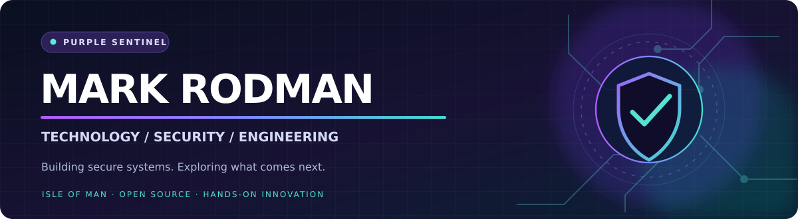

<!-- GitHub profile README for https://github.com/PurpleSentinel -->
<!-- Install in a PUBLIC repository named exactly PurpleSentinel/PurpleSentinel -->

  

   

  
  
  

   
   

  <strong>Technology & Security Leader · Systems Builder · Open-Source Explorer</strong>
   
  Based on the Isle of Man 🇮🇲

---

## 👋 Hello, I'm Mark

I'm a former **Chief Technology & Security Officer** with a background spanning cybersecurity leadership, cloud infrastructure, platform architecture and digital identity.

I enjoy moving between **strategy and hands-on engineering**: designing secure services, investigating how systems behave, building tools that make complex information useful and experimenting with embedded hardware. This GitHub is where those ideas become working projects.

> **My approach:** Security should be designed in, operational reality matters, and the best way to understand a technology is often to build with it.

## 🧭 What I work on

| 🔐 Cybersecurity & DFIR | ☁️ Cloud & Architecture | 🛠️ Software & Hardware |
|:---|:---|:---|
| Security operations, telemetry, incident response and digital forensics | Secure-by-design services, identity, AWS, infrastructure and resilient platforms | Linux desktop apps, visualisation, embedded systems, wireless and GNSS projects |

## 🚀 Featured projects

<table>
<tr>
<td width="50%" valign="top">

<h3>🛡️ <a href="https://github.com/PurpleSentinel/PurpleSentinelStudio">Purple Sentinel Studio</a></h3>

A security operations analyst workspace bringing together IOC management, threat enrichment, investigation utilities and incident workflows.

  

</td>
<td width="50%" valign="top">

<h3>📡 <a href="https://github.com/PurpleSentinel/WiFi-Sentinel">WiFi Sentinel</a></h3>

A receive-only ESP32 wireless intrusion detection prototype, with management-frame telemetry, anomaly rules and a Python collector.

  

</td>
</tr>
<tr>
<td width="50%" valign="top">

<h3>🌃 <a href="https://github.com/PurpleSentinel/cyber-city">CyberCity-3D</a></h3>

Live network traffic visualised as a 3D city: hosts become buildings, subnets become districts, and conversations become highways.

  

</td>
<td width="50%" valign="top">

<h3>🛰️ <a href="https://github.com/PurpleSentinel/neo-m9n-ui">NEO-M9N Monitor</a></h3>

A Fedora GNOME desktop tool for live GNSS diagnostics and troubleshooting of a USB-connected u-blox NEO-M9N receiver.

  

</td>
</tr>
<tr>
<td width="50%" valign="top">

<h3>🎛️ <a href="https://github.com/PurpleSentinel/netspectrum">netspectrum</a></h3>

A GPU-accelerated, audio-equaliser-inspired visualisation of live network traffic. A playful way to see protocols in motion.

 

</td>
<td width="50%" valign="top">

<h3>🌐 <a href="https://github.com/PurpleSentinel/external-ip-monitor">External IP Monitor</a></h3>

A Linux CLI for tracking public IP address changes, geolocation data and optional change notifications.

 

</td>
</tr>
</table>

  

## 🧰 Technologies I use

  
  
  
  
  
  
  
  
  
  

## 🧪 Current interests

- **Wireless security** — passive sensing, authentication telemetry and explainable anomaly detection.
- **Digital identity & privacy** — trustworthy verification, selective disclosure and secure architecture.
- **Cybersecurity tooling** — SOC workflows, DFIR and richer ways to interpret telemetry.
- **Embedded engineering** — GNSS, ESP32, STM32 and Raspberry Pi systems.
- **AI-assisted engineering** — using AI to speed up delivery without compromising review, security or quality.

## 🤝 Connect

For collaboration, technical discussion or to follow what I'm building, explore my public repositories or start a conversation in a relevant project's GitHub Discussions or Issues section (where enabled).

  
  
    
  

